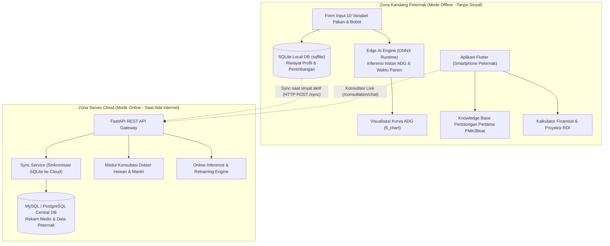
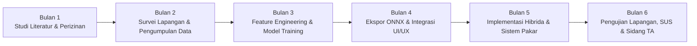

# Development Plan: Sistem Prediksi Waktu Panen Sapi Madura & Konsultasi Dokter Hewan

**Mahasiswa:** Erico Febriyan (NIM: 2023020100055)  
**Program Studi:** S1 Teknik Informatika / Cyber Security (Semester 7)  
**Judul Tugas Akhir:** *Penerapan Algoritma Ensemble Learning untuk Prediksi Waktu Panen Sapi Madura pada Aplikasi Konsultasi Dokter Hewan*  
**Metodologi:** *Applied Research* (Penelitian Terapan)  
**Durasi:** 6 Bulan (12 Sprint Dua-Mingguan)

---

## 1. Ringkasan Eksekutif & Status Kesiapan Sistem

Sistem ini dirancang untuk menyelesaikan permasalahan kritis peternak rakyat di Pulau Madura: ketidakpastian durasi penggemukan (*fattening*), pemberian pakan konvensional tanpa perhitungan ilmiah FCR, minimnya akses dokter hewan di pedesaan, serta ketiadaan kalkulasi finansial *Return on Investment* (ROI).

### Matriks Kesiapan Perangkat Lunak (*Software Readiness Matrix*)

| Komponen | Spesifikasi / Tools | Status Kesiapan | Lokasi Berkas |
| :--- | :--- | :--- | :--- |
| **Frontend Mobile** | Flutter 3.41.1, Dart 3.11.0, Material 3 | ✅ **Siap & Terverifikasi** | `mobile/` |
| **UI & Grafik ADG** | `fl_chart`, `google_fonts` (Poppins) | ✅ **Terpasang** | `mobile/lib/features/prediction/presentation/prediction_result_screen.dart` |
| **Local Offline DB** | SQLite via `sqflite` & `path` | ✅ **Terpasang & Siap** | `mobile/lib/core/database/local_db_helper.dart` |
| **Edge AI Container** | ONNX Runtime Asset Folder | ✅ **Terkonfigurasi** | `mobile/assets/models/` |
| **Backend REST API** | Python 3.13.5 / FastAPI / Uvicorn | ✅ **Siap Dijalankan** | `backend/app/main.py` |
| **Database Server** | SQLAlchemy (SQLite dev / MySQL / Postgres) | ✅ **Terkonfigurasi** | `backend/app/core/database.py` |
| **Dataset Generator** | 10 Fitur Matriks Dataset TA (450 Records) | ✅ **Dataset Template Siap** | `ml_pipeline/dataset/dataset_sapi_madura_template.csv` |
| **ML Training Suite** | XGBoost, RF, GBR, SVR, MLP, K-Fold, ONNX | ✅ **Skrip Pipeline Siap** | `ml_pipeline/train.py` |

---

## 2. Arsitektur Sistem Hibrida (*Hybrid Edge-Cloud Architecture*)

---

## 3. Rencana Kerja 6 Bulan (Timeline & WBS)

### Rincian Sprint Dua-Mingguan

#### Bulan 1: Studi Literatur, Instrumen Data & Perizinan
- **Sprint 1 (Minggu 1-2):**
  - Penyusunan proposal Tugas Akhir bab 1–3 yang telah disesuaikan dengan metodologi Ensemble Learning.
  - Finalisasi kuesioner instrumen survei lapangan untuk pencatatan bobot sapi madura, jenis konsentrat, dan riwayat kesehatan.
  - Pengurusan surat izin penelitian ke Dinas Peternakan Kabupaten di Madura (Bangkalan/Pamekasan) dan kelompok ternak/feedlot mitra.
- **Sprint 2 (Minggu 3-4):**
  - Setup environment lengkap developer (Flutter, FastAPI, Scikit-learn, XGBoost, Git repository).
  - Validasi awal template variabel dataset: `bobot_awal`, `usia_masuk`, `jenis_kelamin`, `jenis_pakan`, `jumlah_pakan_harian`, `frekuensi_pakan`, `kondisi_kesehatan`, `status_vaksinasi`, `target_bobot`.

#### Bulan 2: Pengumpulan Data Primer & Preprocessing
- **Sprint 3 (Minggu 5-6):**
  - Pengambilan data primer di lapangan (feedlot sapi potong Madura & pasar hewan seperti Pasar Hewan Tanah Merah Bangkalan / Keppo Pamekasan).
  - Pencatatan minimal 200–500 data riwayat penimbangan (menggunakan timbangan ternak digital atau pita ukur Rondo/Winter).
- **Sprint 4 (Minggu 7-8):**
  - Pembersihan data (*data cleaning*): penanganan *missing value*, penghapusan data anomali (*outlier removal* dengan batas IQR/Z-Score).
  - Integrasi dataset riil ke dalam struktur `ml_pipeline/dataset/`.

#### Bulan 3: Feature Engineering, Model Training & Evaluasi
- **Sprint 5 (Minggu 9-10):**
  - *Feature Engineering*: kalkulasi rasio pakan terhadap bobot (*Dry Matter Intake ratio*), normalisasi fitur numerik, One-Hot Encoding variabel kategorikal.
  - Pelatihan 5 model kandidat:
    1. **XGBoost Regressor**
    2. **Random Forest Regressor**
    3. **Gradient Boosting Regressor (GBR)**
    4. **Support Vector Regressor (SVR)** *(Baseline)*
    5. **Multi-Layer Perceptron (MLP)** *(Baseline)*
- **Sprint 6 (Minggu 11-12):**
  - Hyperparameter tuning dengan K-Fold Cross-Validation ($k=5$).
  - Perhitungan metrik evaluasi: MAE, RMSE, $R^2$, dan MAPE.
  - Pemilihan model ensemble dengan performa terbaik dan pembuatan laporan komparasi model untuk Bab 4 Skripsi.

#### Bulan 4: Konversi Model ke ONNX & Penguatan UI/UX Mobile
- **Sprint 7 (Minggu 13-14):**
  - Konversi model regresi terbaik ke format ONNX (`sapi_madura_ensemble.onnx`).
  - Verifikasi kesetaraan inferensi (*parity check*) antara Scikit-Learn/XGBoost di Python dengan ONNX Runtime di lingkungan mobile (toleransi selisih $< 10^{-4}$).
- **Sprint 8 (Minggu 15-16):**
  - Integrasi visualisasi grafik fl_chart kurva ADG dengan titik-titik proyeksi dinamis hasil inferensi.
  - Finalisasi alur navigasi aplikasi: Dashboard, Prediksi Panen, Konsultasi Dokter, dan Kalkulator ROI.

#### Bulan 5: Implementasi Arsitektur Hibrida & Expert System
- **Sprint 9 (Minggu 17-18):**
  - Pengujian penyimpanan offline di kandang: SQLite (`sqflite`) menyimpan profil sapi dan log penimbangan harian/mingguan tanpa jaringan internet.
  - Implementasi mekanisme sinkronisasi data ke cloud server FastAPI (`/api/v1/sync/records`) saat perangkat mendeteksi koneksi internet.
- **Sprint 10 (Minggu 19-20):**
  - Penyempurnaan Knowledge Base Dokter Hewan untuk gejala darurat: PMK, Timpani/Bloat, Helminthiasis (cacingan), dan defisiensi nutrisi.
  - Penyempurnaan modul analisis finansial ROI (biaya bakalan, pakan harian $\times$ durasi panen, vaksin, harga jual per kg karkas/hidup).

#### Bulan 6: Pengujian Sistem, SUS, Laporan Akhir & Sidang TA
- **Sprint 11 (Minggu 21-22):**
  - Pengujian fungsionalitas menyeluruh (*Black-Box Testing*) pada berbagai tipe smartphone Android (Android 8 hingga Android 14+).
  - Pengujian usabilitas aplikasi menggunakan metode *System Usability Scale* (SUS) kepada minimal 15–25 responden (peternak Madura, penyuluh, dan dokter hewan/mantri ternak).
- **Sprint 12 (Minggu 23-24):**
  - Rekapitulasi skor SUS dan analisis kepuasan pengguna.
  - Penyelesaian penulisan laporan skripsi (Bab 4 Hasil & Pembahasan, Bab 5 Kesimpulan & Saran).
  - Penyusunan artikel ilmiah/jurnal dan persiapan simulasi sidang Tugas Akhir.

---

## 4. Matriks Metrik Evaluasi & Target Capaian

| Parameter Keberhasilan | Target Akademik Tugas Akhir | Catatan Verifikasi |
| :--- | :--- | :--- |
| **Koefisien Determinasi ($R^2$)** | $\mathbf{\ge 0.85}$ (Sangat Baik) | Menunjukkan model mampu menjelaskan $\ge 85\%$ variansi pertumbuhan bobot. |
| **MAPE (Error Persentase)** | $\mathbf{\le 10.0\%}$ (Akurasi Tinggi) | Rata-rata deviasi estimasi hari panen di bawah 10% dari durasi riil. |
| **MAE Durasi Panen** | $\mathbf{\le 12\text{ hari}}$ | Selisih waktu panen aktual vs prediksi rata-rata kurang dari 2 minggu. |
| **System Usability Scale (SUS)** | $\mathbf{\ge 72.0}$ (*Good / Acceptable*) | Memenuhi standar usabilitas aplikasi peternakan rakyat. |
| **Waktu Inferensi Edge Mobile** | $\mathbf{< 150\text{ ms}}$ | Respon instan di smartphone Android tanpa latensi server. |

---

## 5. Instrumen Pengujian Usabilitas: System Usability Scale (SUS)

Kuesioner 10 pertanyaan standar dengan skala Likert 1 (Sangat Tidak Setuju) sampai 5 (Sangat Setuju):

1. Saya merasa akan sering menggunakan aplikasi prediksi bobot dan panen sapi ini.
2. Saya merasa aplikasi ini terlalu rumit untuk digunakan di lingkungan kandang.
3. Saya merasa aplikasi ini sangat mudah digunakan oleh peternak awam sekalipun.
4. Saya merasa membutuhkan bantuan teknisi atau orang lain untuk dapat menggunakan aplikasi ini.
5. Saya merasa fitur-fitur di dalam aplikasi ini (prediksi panen, grafik kurva ADG, konsultasi dokter, kalkulator ROI) terintegrasi dengan sangat baik.
6. Saya merasa ada terlalu banyak hal yang membingungkan atau tidak konsisten dalam aplikasi ini.
7. Saya merasa sebagian besar peternak dan praktisi veteriner akan cepat memahami cara kerja aplikasi ini.
8. Saya merasa aplikasi ini sangat membingungkan saat digunakan.
9. Saya merasa sangat percaya diri saat menggunakan aplikasi ini secara mandiri di kandang.
10. Saya merasa harus mempelajari banyak hal terlebih dahulu sebelum dapat menggunakan aplikasi ini.

---

## 6. Manajemen Risiko & Mitigasi

| Risiko Potensial | Dampak | Probabilitas | Rencana Mitigasi |
| :--- | :--- | :--- | :--- |
| **Keterbatasan Alat Timbang di Lapangan** | Tinggi | Sedang | Gunakan metode estimasi lingkar dada pita Schoorl/Winter yang telah divalidasi dengan timbangan digital pasar hewan untuk kalibrasi. |
| **Heterogenitas Variasi Pakan Peternak** | Sedang | Tinggi | Sediakan kategori pakan representatif dengan opsi penyesuaian porsi harian (kg) dan frekuensi pakan harian pada fitur form. |
| **Sinyal Lemah / Tidak Ada Sinyal di Kandang** | Tinggi | Tinggi | Terapkan arsitektur *Offline-First*: SQLite lokal & ONNX Edge AI menjalankan inferensi penuh tanpa memerlukan internet. |
| **Performa Rendah pada Smartphone Lawas** | Sedang | Rendah | Model ONNX dikompresi (quantization float16/int8) agar ukuran model ringan ($< 10\text{ MB}$) dan RAM footprint minimal. |

